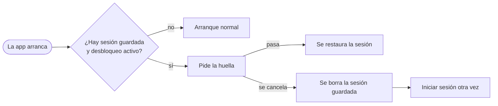
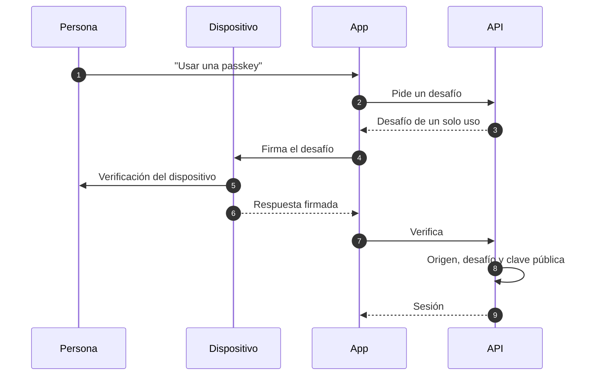

# Desbloqueo con huella y passkeys

Esta página describe dos formas de entrar a Gelpy sin escribir una contraseña: el desbloqueo con huella en Android y las passkeys. Describe flujos, no pantallas, y deja fuera los detalles de implementación que podrían ayudar a un atacante.

:::note Estado

Las passkeys están disponibles en la web desde el 2026-11-07. El desbloqueo con huella está en el build de producción de Android desde el 2026-11-08; ese build se instala como APK, y la app no está en Google Play. Las passkeys en Android están pendientes de verificación en un teléfono, y el vínculo más fuerte de la sesión que se describe abajo está previsto.

:::

| Capacidad | Estado |
|-----------|--------|
| Passkeys en la web | Disponibles desde el 2026-11-07 |
| Desbloqueo con huella en Android | En el build de producción de Android desde el 2026-11-08 |
| Passkeys en Android | Pendientes de verificación en un teléfono: la app las ofrece, y `gelpy.app` publica el archivo Digital Asset Links desde el 2026-11-15 |
| Sesión guardada atada a la verificación de la huella | Previsto: llega a los teléfonos con un nuevo build de Android |
| Contador de la passkey protegido | Previsto |
| iOS | Previsto, postergado |

En los dos casos siguen disponibles, como alternativa, el inicio de sesión con Google y el correo con contraseña.

## Desbloqueo con huella (Android)

- El desbloqueo con huella se activa por decisión propia y viene apagado.
- Protege la restauración de la sesión guardada cuando la app arranca: la app pide la huella primero.
- Solo se aceptan biometrías fuertes.
- Si se cancela, la sesión guardada se borra y hay que iniciar sesión otra vez.
- Los datos biométricos se quedan en el dispositivo. Gelpy nunca los recibe.
- No existe en la web.

### Previsto: un vínculo más fuerte

Estos cambios están previstos. Los teléfonos conservan el build de Android del 2026-11-08 hasta que se apruebe uno nuevo, así que los cambios les llegan con ese build nuevo:

- Si la app no puede leer la preferencia biométrica, la trata como desconocida y no abre ninguna sesión hasta que la verificación pase o la persona inicie sesión otra vez. La app siempre termina en un estado definido.
- La sesión guardada queda atada a la verificación de la huella con una clave sobre (envelope key): una clave aleatoria que se guarda una sola vez en el almacenamiento seguro del dispositivo y que solo se puede leer después de una verificación biométrica exitosa. La sesión se guarda cifrada con esa clave.
- La clave queda en memoria solo mientras la app está desbloqueada. Hay un solo aviso de huella por arranque.
- Si la verificación falla o se cancela, no queda ninguna sesión.
- Registrar una huella nueva hace ilegible la sesión guardada, así que hay que iniciar sesión otra vez.
- Las sesiones guardadas a la manera anterior pasan al almacenamiento nuevo en su siguiente desbloqueo.

## Passkeys

- Las passkeys siguen el estándar WebAuthn. El servidor las registra, las verifica y las revoca.
- Cada entorno tiene su propio relying party. El de producción es `gelpy.app`, y un relying party de test nunca es válido en producción.
- Se entra con "Usar una passkey" en la pantalla de inicio de sesión.
- Una sección Passkeys en Perfil › Cuenta permite crear, listar y revocar las passkeys propias.
- Cada desafío vence y sirve una sola vez. Solo se aceptan los orígenes configurados del entorno.
- El dispositivo guarda la clave privada. La base de datos guarda solo la clave pública.
- Una passkey revocada falla, y el inicio de sesión con Google sigue funcionando.

### Previsto: un contador protegido

El contador de firmas de la passkey subirá en un solo paso protegido antes de que exista ninguna sesión, y solo mientras la passkey está activa. Así, una passkey clonada, reutilizada o recién revocada no podrá abrir una sesión. La auditoría de un intento fallido guardará solo el motivo.

### Passkeys en Android

El build de producción de Android ofrece las passkeys, y desde el 2026-11-15 `gelpy.app` publica el archivo Digital Asset Links, que vincula la app con el sitio. Todavía no se probaron de punta a punta en un teléfono, así que están pendientes de verificación y no figuran como disponibles.

## Lo que nunca se guarda

| Gelpy nunca guarda | Por qué |
|--------------------|---------|
| Claves privadas de las passkeys | Se quedan en el dispositivo; la base de datos solo tiene claves públicas |
| Datos biométricos | Se quedan en el dispositivo; Gelpy nunca los recibe |
| Contraseñas en claro | Solo se guardan hashes argon2id |

- Los desafíos son registros de un solo uso que vencen.
- Los logs nunca guardan contraseñas, códigos de un solo uso, tokens ni datos personales.

## Páginas relacionadas

- [Identidad e inicio de sesión](./identity.md)
- [Visión general de seguridad](./overview.md)
- [Base de la app](../architecture/app-shell.md)
