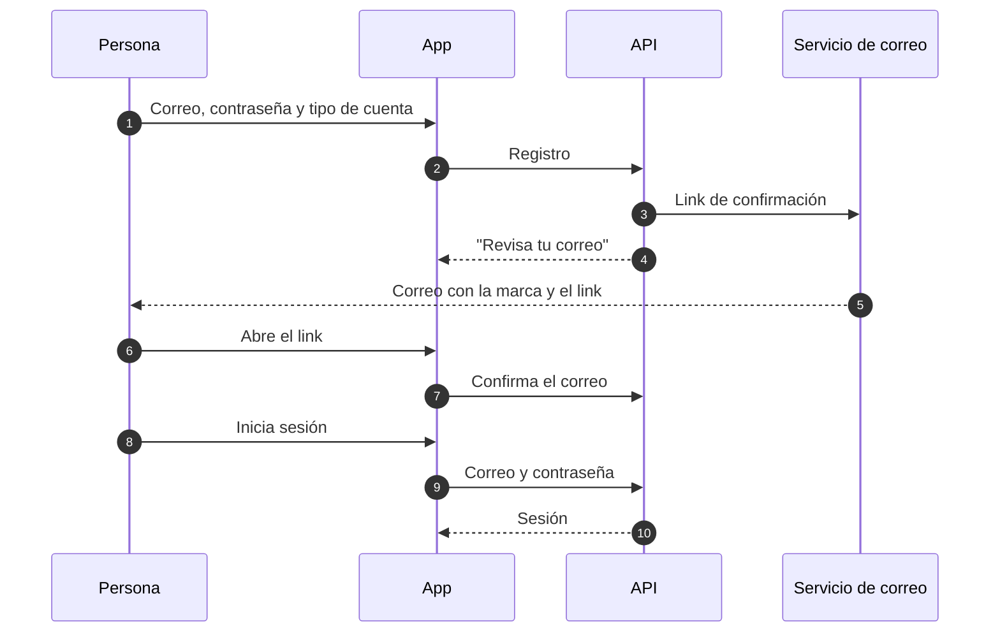

# Identidad e inicio de sesión

Esta página describe cómo las personas crean una cuenta e inician sesión en Gelpy, cómo los admins entran a la consola y cómo se protegen los datos de identidad. Describe flujos, no pantallas.

:::note Estado

La identidad está en producción desde el 2026-11-07 en la web: en la versión web de la app y en la consola de admins. La app de Android sigue en preview, así que la identidad en Android corre solo en el build preview de Android hasta el primer build de producción de Android. Cada sección indica dónde funciona hoy cada parte.

:::

| Capacidad | Estado |
|-----------|--------|
| Correo y contraseña, con link de confirmación por correo | Producción |
| Inicio de sesión con Google en la web | Producción |
| Inicio de sesión con Google en Android | Build preview de Android; producción con el primer build de producción de Android |
| Verificación del teléfono por SMS | Producción |
| Desbloqueo con huella en Android | Build preview de Android; producción con el primer build de producción de Android |
| Passkeys | Producción en la web; build preview de Android |
| Consola de admins solo con cuentas Google de `gelpy.app` | Producción |

## Tipos de cuenta

Al registrarse, con cualquier método, cada persona elige cómo usa Gelpy:

- **Gelpie**: alguien que necesita ayuda.
- **Gelper**: un profesional que ofrece servicios.
- **Ambos**.

La cuenta no se crea hasta que se elige un tipo, también en el primer inicio de sesión con Google. Después se puede agregar el otro tipo desde Perfil.

Las cuentas también tienen una marca interna de admin. Está apagada por defecto, y ninguna parte pública de la API puede activarla.

## Correo y contraseña

- La contraseña debe tener de 8 a 64 caracteres, sin reglas de composición, según NIST SP 800-63B.
- Las contraseñas se guardan solo como hashes argon2id y nunca aparecen en respuestas ni en logs.
- La cuenta empieza sin confirmar. No se emite ninguna sesión hasta confirmar el correo.
- El link de confirmación sirve una sola vez y dura 24 horas. Solo se guarda un hash de su token, y el token viaja en la parte del link que los navegadores no envían a los servidores.
- El reenvío del link y los inicios de sesión fallidos tienen límites por cuenta.
- Los correos de confirmación y los avisos llevan la marca Gelpy.

### Sin enumeración de cuentas

Nada revela si un correo ya tiene cuenta:

- Un inicio de sesión fallido con un correo desconocido se ve igual que una contraseña incorrecta: la misma respuesta y el mismo tiempo.
- Registrarse con un correo que ya tiene cuenta da la misma respuesta "Revisa tu correo" que una cuenta nueva. Solo el dueño de ese correo recibe un aviso, que lo saluda con el nombre que ya tiene su cuenta.

## Google

- Google prueba el correo, así que una cuenta de Google empieza con el correo confirmado.
- La API revisa cada token de Google: quién lo emitió, para qué app se emitió, que no haya vencido y que el correo esté verificado. Un token emitido para otra app se rechaza.
- En la web, la app recibe el token de Google directamente en el navegador.
- En Android, la app usa el Credential Manager del sistema. Corre en el build preview de Android y llega a producción con el primer build de producción de Android.
- No se usa ni se guarda ningún secreto de cliente de Google.

Si alguien se registró con un correo y una contraseña pero nunca lo confirmó, y el dueño real de ese correo inicia sesión después con Google, la API primero elimina la contraseña sin confirmar y cierra sus sesiones. Así se bloquea la toma de cuentas antes de su creación.

## Teléfono

- Después de iniciar sesión, la app ofrece agregar un número de teléfono una vez por cuenta y dispositivo. Se puede omitir y agregar después desde Perfil.
- El teléfono se verifica con un código de 6 dígitos enviado por SMS a través de Twilio Verify.
- En la Fase 1 solo se aceptan números de Perú (+51).
- Los códigos vencen a los 10 minutos y admiten un número limitado de intentos. Los envíos tienen límites por cuenta.
- La app muestra el número enmascarado, por ejemplo "+51 9•• ••• •12". El número completo nunca aparece en los logs.

## Sesiones

- Un inicio de sesión emite un token de acceso y un token de refresco.
- Cada token de refresco sirve una sola vez: al usarlo se emite uno nuevo, y reusar uno viejo falla.
- Cerrar sesión termina la sesión, y su token de refresco deja de funcionar.
- Los tokens nunca se guardan con las preferencias locales de la app.

## Desbloqueo con huella (Android)

- En Android se puede activar el desbloqueo con huella. Así, la app la pide antes de restaurar una sesión guardada.
- Solo se aceptan biometrías fuertes.
- Si se cancela, la sesión guardada se borra y hay que iniciar sesión otra vez.
- Corre en el build preview de Android, probado en un teléfono físico, y llega a producción con el primer build de producción de Android.

## Passkeys

- Las personas pueden crear, usar y revocar passkeys. El servidor las registra, las verifica y las revoca.
- Cada desafío vence y sirve una sola vez, y solo se aceptan los orígenes del propio entorno.
- Ninguna clave privada llega a Gelpy: la guarda el dispositivo.
- Las passkeys funcionan en producción en la web. En Android corren en el build preview de Android y llegan a producción con el primer build de producción de Android.

## Consola de admins

La consola de admins es solo para los operadores de Gelpy. Solo se entra con cuentas Google de la organización `gelpy.app`:

- Google mismo rechaza las cuentas de fuera de la organización.
- La API acepta un inicio de sesión en la consola solo si el token se emitió para la consola, la cuenta pertenece a `gelpy.app`, su correo está verificado y la cuenta ya existe como admin. El inicio de sesión de la consola nunca crea cuentas.
- Las sesiones de la consola están separadas de las de la app y duran menos. Las acciones de admin solo aceptan sesiones de la consola, así que la sesión de la app de un admin no puede hacerlas.
- Cualquier otra persona ve una página sin acceso, y no se guarda ninguna sesión.

Los roles de admin por módulo de la consola llegan en la Fase 2.

## Manejo de datos

| Dato | Dónde vive | Reglas |
|------|------------|--------|
| Correo, nombre, teléfono | Base de datos | Se recogen solo cuando hacen falta; el teléfono se muestra enmascarado |
| Contraseña | Base de datos, como hash argon2id | Nunca se guarda, se devuelve ni se registra en claro |
| Links de confirmación | Base de datos, como hashes | Un solo uso, 24 horas |
| Códigos SMS | El proveedor de SMS | Gelpy nunca los guarda ni los registra |
| Sesiones | Base de datos, como hashes | Los tokens de refresco rotan; cerrar sesión los revoca |
| Passkeys | Clave pública en la base de datos; clave privada en el dispositivo | Desafíos de un solo uso |

- Los logs nunca registran contraseñas, códigos, tokens ni datos personales.
- Los eventos de seguridad, como una contraseña sin confirmar que se elimina, quedan auditados sin datos personales.
- Test y producción tienen cuentas, claves y configuración separadas.

## Páginas relacionadas

- [Visión general de seguridad](./overview.md)
- [Flujo de datos](../architecture/data-flow.md)
- [Base de la app](../architecture/app-shell.md)
