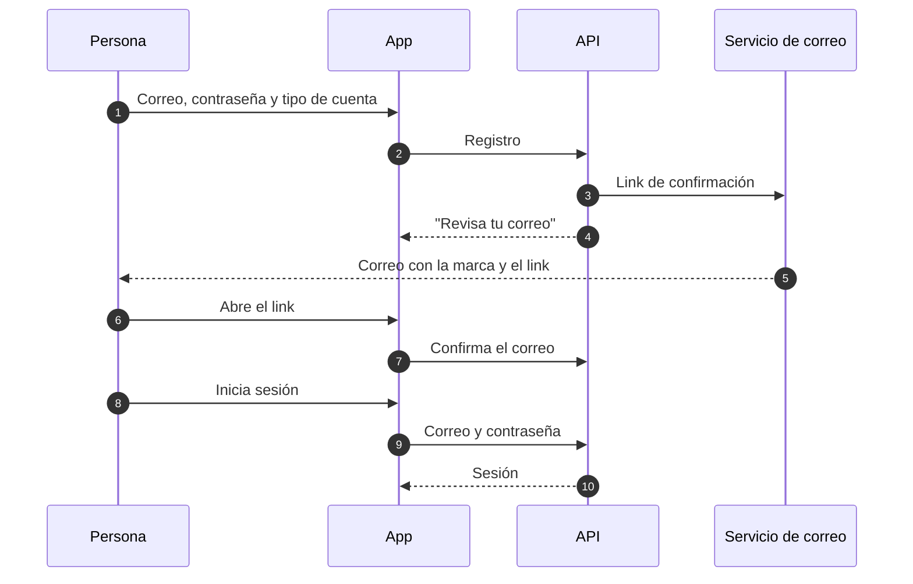

# Identidad e inicio de sesión

Esta página describe cómo las personas crean una cuenta e inician sesión en Gelpy, cómo los admins entran a la consola y cómo se protegen los datos de identidad. Describe flujos, no pantallas.

:::note Estado

La identidad está en producción desde el 2026-11-07 en la web: en la versión web de la app y en la consola de admins. El primer build de producción de Android salió el 2026-11-08. Se instala como APK; la app no está en Google Play. Desde el 2026-11-15, el registro es solo por invitación, y la consola tiene roles y permisos. Las pantallas nuevas de la app de ese día están en la web; Android las recibe con su próximo build. Cada sección indica dónde funciona hoy cada parte.

:::

| Capacidad | Estado |
|-----------|--------|
| Correo y contraseña, con link de confirmación por correo | Producción |
| Inicio de sesión con Google en la web | Producción |
| Inicio de sesión con Google en Android | En el build de producción de Android desde el 2026-11-08 |
| Verificación del teléfono por SMS | Producción |
| Desbloqueo con huella en Android | En el build de producción de Android desde el 2026-11-08 |
| Passkeys | Disponibles en la web. En Android, la app las ofrece y `gelpy.app` publica el archivo Digital Asset Links desde el 2026-11-15, pero están pendientes de verificación en un teléfono |
| Aceptación obligatoria de los términos y la política de privacidad al registrarse | Producción desde el 2026-11-08 |
| Registro solo por invitación | Producción desde el 2026-11-15 |
| Aceptar una nueva versión mayor de los textos legales, la pausa de mantenimiento, la desactivación de cuentas y vincular Google con la sesión iniciada | Producción desde el 2026-11-15; las pantallas de la app están en la web, y Android las recibe con su próximo build |
| Consola de admins solo con cuentas Google de `gelpy.app` | Producción |
| Roles y permisos de la consola | Producción desde el 2026-11-15 |

## Tipos de cuenta

Al registrarse, con cualquier método, cada persona elige cómo usa Gelpy:

- **Gelpie**: alguien que necesita ayuda.
- **Gelper**: un profesional que ofrece servicios.
- **Ambos**.

La cuenta no se crea hasta que se elige un tipo, también en el primer inicio de sesión con Google. La app todavía no puede agregar el otro tipo a una cuenta existente.

Desde el 2026-11-08, registrarse también requiere marcar una casilla que acepta los términos y la política de privacidad. La cuenta guarda un registro de esa aceptación, con las versiones de los textos. Cuando un texto legal tiene una nueva versión mayor, la app en la web pide a cada cuenta aceptarlo otra vez antes de seguir.

Las cuentas también tienen una marca interna de admin. Está apagada por defecto, y ninguna parte pública de la API puede activarla.

## Registro por invitación

Desde el 2026-11-15, el registro está cerrado. Solo una invitación del equipo de Gelpy permite que una persona cree una cuenta:

- El equipo envía la invitación desde la consola de administración.
- El link de la invitación sirve una sola vez, solo para el correo invitado, y vence el día que muestra.
- Solo se guarda un hash del token de la invitación.
- Mientras el registro está cerrado, la app ofrece solo iniciar sesión, y todo otro intento de registro recibe la misma respuesta de registro cerrado.

## Correo y contraseña

- La contraseña debe tener de 8 a 64 caracteres, sin reglas de composición, según NIST SP 800-63B.
- Las contraseñas se guardan solo como hashes argon2id y nunca aparecen en respuestas ni en logs.
- La cuenta empieza sin confirmar. No se emite ninguna sesión hasta confirmar el correo.
- El link de confirmación sirve una sola vez y dura 24 horas. Solo se guarda un hash de su token, y el token viaja en la parte del link que los navegadores no envían a los servidores.
- El reenvío del link y los inicios de sesión fallidos tienen límites por cuenta.
- Los correos de confirmación y los avisos llevan la marca Gelpy.

### Sin enumeración de cuentas

Nada revela si un correo ya tiene cuenta:

- Un inicio de sesión fallido con un correo desconocido se ve igual que una contraseña incorrecta: la misma respuesta y el mismo tiempo.
- Mientras el registro está cerrado, todo intento de registro recibe la misma respuesta de registro cerrado, sea cual sea el correo, antes de cualquier búsqueda.
- Cuando el registro está abierto, registrarse con un correo que ya tiene cuenta da la misma respuesta "Revisa tu correo" que una cuenta nueva. Solo el dueño de ese correo recibe un aviso, que lo saluda con el nombre que ya tiene su cuenta.

## Google

- Google prueba el correo, así que una cuenta de Google empieza con el correo confirmado.
- La API revisa cada token de Google: quién lo emitió, para qué app se emitió, que no haya vencido y que el correo esté verificado. Un token emitido para otra app se rechaza.
- En la web, la app recibe el token de Google directamente en el navegador.
- En Android, la app usa el Credential Manager del sistema. Está en el build de producción de Android desde el 2026-11-08.
- No se usa ni se guarda ningún secreto de cliente de Google.

En la web, una persona con la sesión iniciada también puede vincular Google a la cuenta desde Perfil, en "Seguridad y acceso". Necesita un inicio de sesión reciente con Google y un correo confirmado.

Si alguien se registró con un correo y una contraseña pero nunca lo confirmó, y el dueño real de ese correo inicia sesión después con Google, la API primero elimina la contraseña sin confirmar y cierra sus sesiones. Así se bloquea la toma de cuentas antes de su creación.

## Teléfono

- Después de iniciar sesión, la app ofrece agregar un número de teléfono una vez por cuenta y dispositivo. Se puede omitir y agregar después desde Perfil.
- El teléfono se verifica con un código de 6 dígitos enviado por SMS a través de Twilio Verify.
- En la Fase 1 solo se aceptan números de Perú (+51).
- Los códigos vencen a los 10 minutos y admiten un número limitado de intentos. Los envíos tienen límites por cuenta.
- La app muestra el número enmascarado, por ejemplo "+51 9•• ••• •12". El número completo nunca aparece en los logs.

## Sesiones

- Un inicio de sesión emite un token de acceso y un token de refresco.
- Cada token de refresco sirve una sola vez: al usarlo se emite uno nuevo, y reusar uno viejo falla.
- Cerrar sesión termina la sesión, y su token de refresco deja de funcionar.
- Los tokens nunca se guardan con las preferencias locales de la app.
- El equipo puede pausar el inicio de sesión de la app por mantenimiento. La pausa aplica solo a la app, nunca a la consola. También detiene el registro y las invitaciones, y no cierra ninguna sesión.
- El equipo puede desactivar una cuenta con un motivo. Todas sus sesiones se cierran al instante, y no puede iniciar sesión. La desactivación conserva los datos; no es una eliminación. Nadie puede desactivar su propia cuenta, al Super admin ni a un miembro de la consola.

## Desbloqueo con huella (Android)

- En Android se puede activar el desbloqueo con huella. Así, la app la pide antes de restaurar una sesión guardada.
- Solo se aceptan biometrías fuertes.
- Si se cancela, la sesión guardada se borra y hay que iniciar sesión otra vez.
- Está en el build de producción de Android desde el 2026-11-08.
- Consulta [Desbloqueo con huella y passkeys](./biometrics-passkeys.md) para ver el flujo y los cambios previstos.

## Passkeys

- Las personas pueden crear, usar y revocar passkeys. El servidor las registra, las verifica y las revoca.
- Cada desafío vence y sirve una sola vez, y solo se aceptan los orígenes del propio entorno.
- Ninguna clave privada llega a Gelpy: la guarda el dispositivo.
- Las passkeys están disponibles en la web. En Android, la app las ofrece y `gelpy.app` publica el archivo Digital Asset Links desde el 2026-11-15, pero están pendientes de verificación en un teléfono.
- Consulta [Desbloqueo con huella y passkeys](./biometrics-passkeys.md) para ver el flujo y lo que nunca se guarda.

## Consola de admins

La consola de admins es solo para los operadores de Gelpy. Solo se entra con cuentas Google de la organización `gelpy.app`:

- Google mismo rechaza las cuentas de fuera de la organización.
- La API acepta un inicio de sesión en la consola solo si el token se emitió para la consola, la cuenta pertenece a `gelpy.app`, su correo está verificado y la cuenta está activa y tiene un rol, o es el Super admin.
- El primer inicio de sesión de una cuenta de la organización la registra como miembro del equipo sin rol. No empieza ninguna sesión, y la consola le pide solicitar un rol al Super admin. El inicio de sesión de la consola nunca crea una cuenta de la app.
- Las sesiones de la consola están separadas de las de la app y duran menos. Las acciones de admin solo aceptan sesiones de la consola, así que la sesión de la app de un admin no puede hacerlas.
- Cualquier otra persona ve una página sin acceso, y no se guarda ninguna sesión.

Desde el 2026-11-15, el Super admin arma roles a partir de permisos en el módulo Acceso y los asigna a los miembros del equipo. Cada miembro ve solo los módulos y las acciones de sus roles. Exportar es siempre un permiso propio. Cada cambio registra quién lo hizo, sin nombre, correo ni dirección IP.

## Manejo de datos

| Dato | Dónde vive | Reglas |
|------|------------|--------|
| Correo, nombre, teléfono | Base de datos | Se recogen solo cuando hacen falta; el teléfono se muestra enmascarado |
| Contraseña | Base de datos, como hash argon2id | Nunca se guarda, se devuelve ni se registra en claro |
| Links de confirmación | Base de datos, como hashes | Un solo uso, 24 horas |
| Invitaciones de registro | Base de datos; el token como hash | Un solo uso, solo para el correo invitado |
| Códigos SMS | El proveedor de SMS | Gelpy nunca los guarda ni los registra |
| Sesiones | Base de datos, como hashes | Los tokens de refresco rotan; cerrar sesión los revoca |
| Passkeys | Clave pública en la base de datos; clave privada en el dispositivo | Desafíos de un solo uso |

- Los logs nunca registran contraseñas, códigos, tokens ni datos personales.
- Los eventos de seguridad, como una contraseña sin confirmar que se elimina, quedan auditados sin datos personales.
- Test y producción tienen cuentas, claves y configuración separadas.

## Páginas relacionadas

- [Visión general de seguridad](./overview.md)
- [Desbloqueo con huella y passkeys](./biometrics-passkeys.md)
- [Flujo de datos](../architecture/data-flow.md)
- [Base de la app](../architecture/app-shell.md)
